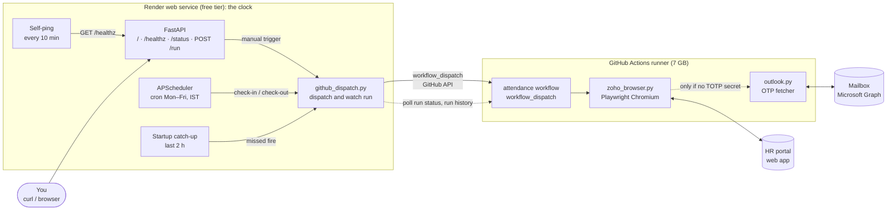
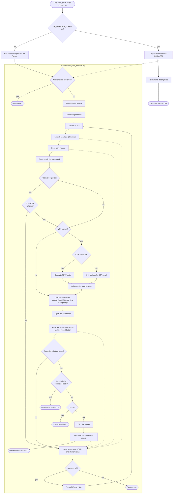
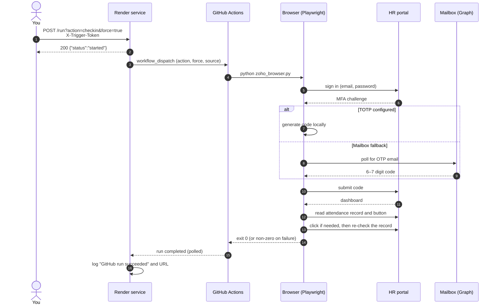

# Attendance Bot

A scheduled browser-automation service that performs the daily check-in and check-out on a web-based HR portal. A small always-on service keeps exact time, and a GitHub Actions runner drives a headless Chromium (Playwright) to log in, clear MFA, and press the attendance button.


> This is a generic template. It contains no credentials, accounts or organisation-specific data. Everything is configured through environment variables and repository secrets.

## Features

- **Exact-time scheduling**: APScheduler cron pinned to a timezone (default `Asia/Kolkata`), Mon–Fri, firing within about a second.
- **Offloaded browser**: each fire dispatches a GitHub Actions workflow, so Chromium runs on a 7 GB runner instead of a 512 MB free instance.
- **Self-healing**: a startup catch-up reads GitHub's run history and re-dispatches any recent fire that has no successful run.
- **Two MFA strategies**: TOTP (preferred) or one-time codes read from a mailbox via Microsoft Graph.
- **Safe punching**: decides from the portal's attendance record, confirms the punch afterwards, and never ends other sessions.
- **Resilient**: 3 retries with exponential backoff (10 s → 20 s → 40 s), small random jitter, weekend guard, sign-out after every run.
- **Observable**: health and status endpoints, run logs, and failure screenshots uploaded as run artifacts.
- **Manual trigger**: token-protected `POST /run` endpoint and a dry-run mode that never clicks.

## How it works

### System architecture



Without `GH_DISPATCH_TOKEN` the service falls back to running Chromium in-process on Render. That works, but the free instance often runs out of memory, and the catch-up stays off.

### Execution flow



### Request sequence (smoke test)



### Why the work is split

GitHub Actions cron is best-effort and drifts by 5–30+ minutes at peak times, so the schedule lives on a small service instead. Running the browser on that service's free instance has the opposite problem: 512 MB of memory is not enough for Chromium plus a heavy single-page app, so runs crawl and get killed. The service therefore keeps the clock and GitHub runs the browser, at about 5 runner-minutes a day.

### Schedule (configurable)

| Action | Time (IST) | Days |
|--------|------------|------|
| Check-in | `12:00` | Mon–Fri |
| Check-out | `22:00` | Mon–Fri |

A random 0–60 s jitter is added so the timing isn't perfectly mechanical.

## Setup: fork and deploy

### Prerequisites

- An account on the supported HR portal, with the attendance widget enabled
- A free **Render** account
- A **GitHub** account (to fork the repo so Render can auto-deploy on push)
- Either a **TOTP secret** for the portal's MFA *(recommended)*, or an **Outlook / M365 mailbox** that receives the OTP emails

### Step 1: Fork

Fork this repository to `https://github.com/<your-user>/attendance-bot`.

### Step 2: Gather your secrets

| Variable | Required | Notes |
|----------|----------|-------|
| `ZOHO_EMAIL` | yes | Portal login email |
| `ZOHO_PASSWORD` | yes | Portal password |
| `ZOHO_TOTP` | recommended | The long TOTP secret behind the QR code, not the 6-digit code. In the portal's account security page choose MFA → authenticator app → "Can't scan? Show secret key". Disable and re-enable TOTP if you can't see it again. |
| `OUTLOOK_EMAIL` + `OUTLOOK_PASSWORD` | only if no TOTP | Mailbox receiving the OTP emails. If your tenant enforces MFA, use an app password (account.microsoft.com → Security → Advanced). Personal Outlook accounts usually work directly. |
| `TRIGGER_TOKEN` | auto | Render generates it from `render.yaml`. Use it for the manual `/run` endpoint. |

### Step 3: Deploy via Blueprint

1. In Render: **New → Blueprint**, connect GitHub, select your fork.
2. Render reads `render.yaml` and proposes a Docker web service in Singapore.
3. Fill in the secret variables when prompted, then click **Apply**.

The first build pulls the Playwright base image (about 600 MB, 3–5 minutes). Open the service URL afterwards and you should see:

```json
{
  "service": "zoho-attendance-bot",
  "now_ist": "2026-05-04T11:58:42+05:30",
  "schedule": {
    "checkin":  "12:00 IST Mon-Fri",
    "checkout": "22:00 IST Mon-Fri"
  },
  "next_runs": {
    "checkin":  "2026-05-04T12:00:00+05:30",
    "checkout": "2026-05-04T22:00:00+05:30"
  }
}
```

### Step 4: Run the browser on GitHub Actions

1. **Add secrets to GitHub.** Fork → **Settings → Secrets and variables → Actions**. Add `ZOHO_EMAIL`, `ZOHO_PASSWORD`, and either `ZOHO_TOTP` or `OUTLOOK_EMAIL` + `OUTLOOK_PASSWORD`, with the same values you gave Render.
2. **Enable the workflow.** On the **Actions** tab, open the attendance workflow and click **Enable workflow** if needed. It has no schedule of its own and only runs when dispatched.
3. **Create a token.** GitHub → Settings → Developer settings → fine-grained tokens. Select only your fork and set **Actions: Read and write**. Note the expiry: dispatches fail once it expires.
4. **Give it to Render.** Add `GH_DISPATCH_TOKEN` in the service's **Environment** tab. After the redeploy the log shows `Browser runs on GitHub Actions (<you>/attendance-bot, attendance.yml@main)`.

### Step 5: Smoke-test

A **dry run** logs in and reads the button without clicking, so it is safe at any time:

```bash
gh workflow run attendance.yml -f action=checkin -f dry_run=true
gh run watch
```

Look for `Widget text: check-in` followed by `Result: dry-run: would click 'check-in'`.

Then test the Render → GitHub path end to end. This fires a **real** punch, and `force=true` bypasses the weekend gate:

```bash
curl -X POST "https://<your-service>.onrender.com/run?action=checkin&force=true" \
     -H "X-Trigger-Token: <your-token>"
```

Expected reply: `{"status":"started","action":"checkin","force":true}`. In the Render logs you should see the dispatch, the run moving from `queued` to `completed`, and `GitHub run succeeded` with a link. To undo the test, run `action=checkout` the same way.

## API

| Method | Path | Purpose | Auth |
|--------|------|---------|------|
| `GET` | `/` | Service info and next run times | none |
| `GET` | `/healthz` | Liveness probe (Render and the self-ping) | none |
| `GET` | `/status` | Scheduler state and next runs | none |
| `POST` | `/run?action=checkin\|checkout[&force=true]` | Manual trigger | `X-Trigger-Token` header |

`force=true` skips both the weekend gate and the jitter, so you can test on any day.

## Configuration

All optional, set in the Render **Environment** tab. A change triggers a redeploy.

| Variable | Default | Purpose |
|----------|---------|---------|
| `CHECKIN_HOUR` / `CHECKIN_MIN` | `12` / `0` | Check-in time (IST) |
| `CHECKOUT_HOUR` / `CHECKOUT_MIN` | `22` / `0` | Check-out time (IST) |
| `SELF_PING_INTERVAL` | `600` | Self-ping interval in seconds |
| `SELF_PING_URL` | *(auto)* | Override the ping URL; derived from `RENDER_EXTERNAL_URL` |
| `GH_DISPATCH_TOKEN` | *(unset)* | Token with **Actions: Read and write**. Set: browser runs on GitHub. Unset: it runs in-process on Render. |
| `GH_DISPATCH_REPO` | *(auto)* | `owner/repo` to dispatch; derived from `RENDER_GIT_REPO_SLUG` |
| `GH_DISPATCH_WORKFLOW` | `attendance.yml` | Workflow file to dispatch |
| `GH_DISPATCH_REF` | *(auto)* | Branch to run; defaults to the deployed branch |
| `CATCHUP_WINDOW_MINUTES` | `120` | On startup, re-dispatch a fire from the last N minutes with no successful run |
| `DEBUG_DIR` | `/tmp/attendance-debug` | Failure screenshots (uploaded as run artifacts on GitHub) |

## Local development

```bash
git clone https://github.com/<your-user>/attendance-bot.git
cd attendance-bot

python3 -m venv .venv && source .venv/bin/activate
pip install -r requirements.txt
playwright install chromium

# create a .env (gitignored) with ZOHO_EMAIL, ZOHO_PASSWORD, etc.

# one-off CLI run (DRY_RUN=true logs in without clicking):
ACTION=checkin DRY_RUN=true python zoho_browser.py

# full service (scheduler and endpoints) on http://localhost:8000:
uvicorn app:app --reload --port 8000

# tests (no network; the interstitial tests drive headless Chromium and
# skip themselves if `playwright install chromium` hasn't been run):
pip install -r requirements-dev.txt
pytest
```

## Troubleshooting

| Symptom | Cause and fix |
|---------|---------------|
| `ZoneInfoNotFoundError: 'No time zone found with key Asia/Kolkata'` | Old commit. Pull latest: the Dockerfile installs `tzdata` and `requirements.txt` has the pip fallback. |
| Build hangs at `Configuring tzdata` | Same: pull latest, which sets `DEBIAN_FRONTEND=noninteractive` and pre-seeds `/etc/timezone`. |
| `BrowserType.launch: Executable doesn't exist` | The pip `playwright` version and the Docker base image tag differ. Both are pinned to `1.59.0`; change them together. |
| `Missing env vars: ...` | Secrets not set. Add them in the Environment tab (or as GitHub secrets for the workflow). |
| `OTP required but no source configured` | MFA was requested but neither `ZOHO_TOTP` nor the mailbox variables are set. |
| `MFA is REQUIRED on this account. ROPC ...` | The tenant blocks password grant. Use an app password or switch to TOTP. |
| Render restarts mid-run, or `Locator.click` / `wait_for_selector` time out | The browser is running on the 512 MB free instance and running out of memory. Complete [Step 4](#step-4-run-the-browser-on-github-actions). |
| `GitHub API returned HTTP 401` | The token expired or was revoked. Create a new one and update `GH_DISPATCH_TOKEN`. |
| `GitHub API returned HTTP 403 / 404` | The token can't see the repo or lacks **Actions: Read and write**, or `GH_DISPATCH_REPO` / `GH_DISPATCH_WORKFLOW` is wrong. |
| `GitHub API returned HTTP 422` | The workflow is disabled, or the branch's workflow file lacks the inputs the service sends. Enable it and update the branch. |
| `attendance record: ...; but the dashboard button says ...` | The record and the button disagree. The bot refuses to click. Punch manually and check the run's screenshots (`gh run download <run-id>`). |
| `Clicked ..., but the attendance record still shows: ...` | The click went through but the record didn't update after four checks about 10 s apart. Check the portal and punch manually if needed. |
| `blocking sign-in until other sessions end` | Too many active sessions. The bot never terminates them. End old sessions in the portal's account page, then re-run. |
| Login fails or the widget isn't found | Follow the GitHub run link from the failed job and download its screenshot artifact. The portal's markup may have changed, so check the selectors in `zoho_browser.py`. |

## Security notes

- Never commit secrets. `.env` is gitignored.
- Rotate `TRIGGER_TOKEN` if it appears in a chat, issue or screenshot (Render → Environment → edit → Save).
- Rotate the portal and mailbox passwords if they are ever exposed, and replace `GH_DISPATCH_TOKEN` before it expires.
- `/run` is reachable from the internet. Keep `TRIGGER_TOKEN` a long random value (Render generates one).
- Use this only with accounts you own, and follow the policies of the service you automate.

## Files in this repo

| File | What it does |
|------|--------------|
| `app.py` | FastAPI service, APScheduler, endpoints, self-ping, startup catch-up |
| `github_dispatch.py` | Dispatches the workflow, watches the run, reads run history |
| `.github/workflows/attendance.yml` | GitHub Actions job that runs the browser |
| `.github/workflows/keep-alive.yml` | Keeps the repo active so scheduled workflows aren't disabled |
| `zoho_browser.py` | Playwright automation: login, MFA, interstitials, punch, confirm |
| `outlook.py` | Microsoft Graph poll for OTP emails |
| `Dockerfile` | Container build; installs `tzdata`, pins Playwright |
| `render.yaml` | Blueprint: web service, env vars, health check, region |
| `requirements.txt`, `requirements-dev.txt` | Pinned runtime and test dependencies |
| `tests/` | pytest suite (GitHub API faked at the HTTP layer) |

## Tech stack

Python 3.11 · FastAPI · Uvicorn · APScheduler · Playwright (Chromium) · PyOTP · GitHub Actions · Microsoft Graph · Docker · Render
