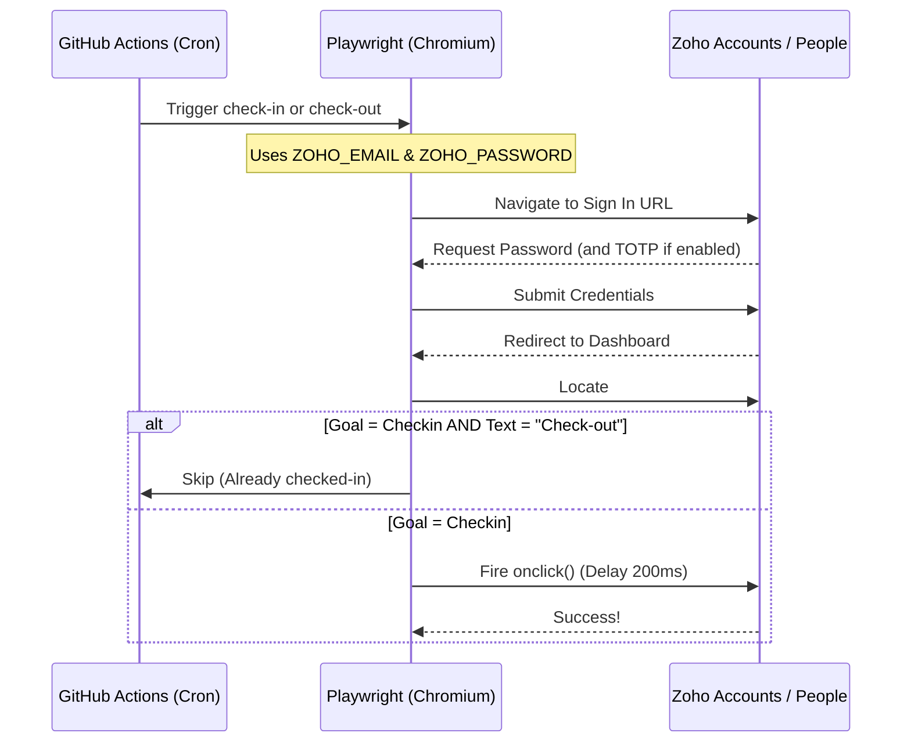

  
  <h1>Zoho Attendance Bot (Browser/Playwright)</h1>
  
<strong>A fully automated, role-bypassing Zoho People check-in/out bot using Playwright and GitHub Actions.</strong>

  

    
    
    
  

---

## 🚀 Overview

This repository automates the daily **Check-in** and **Check-out** process for Zoho People. Due to API role restrictions missing `ZOHOPEOPLE.attendance.ALL`, this project uses a genuine **Playwright Chromium browser** run headlessly in the cloud to simulate human logins.

It executes exclusively on Mon–Fri via GitHub Actions Cron expressions configured to your specific local times.

### ⏱️ Schedule (IST = UTC+5:30)
- **Check-in:** 12:00 PM IST `(06:30 UTC)`
- **Check-out:** 10:00 PM IST `(16:30 UTC)`

---

## ⚙️ How it Works

---

## 🛠️ Repository Setup

### 1. Variables and Secrets
Before you can run the bot, you need to add your login information. Inside your repository, go to **Settings → Secrets and variables → Actions** and add the following repository secrets:

| Secret Name | Description | Required? |
|-------------|-------------|-----------|
| `ZOHO_EMAIL` | Your Zoho login email address | Yes |
| `ZOHO_PASSWORD` | Your Zoho password | Yes |
| `ZOHO_TOTP` | Your TOTP secret code | Only if 2FA/MFA is enabled |

### 2. Manual Triggers
You can manually run the workflow at any time if you miss a check-in:
1. Go to the **Actions** tab in GitHub.
2. Select **Zoho People Attendance (Browser)** on the left.
3. Click the **Run workflow** dropdown, choose your action (`checkin` or `checkout`), and run it.

---

## 📸 Debugging & Snapshots

If the automation fails (e.g., Zoho changes their login design or an unexpected CAPTCHA appears), the GitHub Action immediately securely uploads a `debug_screenshot.png` artifact to the workflow run.

To retrieve it:
1. Go to your failed Action run.
2. Scroll to the bottom and click on **Artifacts**.
3. Download `debug-screenshot` to inspect what the browser saw right before it failed.

---

  
   
  <b>Built for automated, hassle-free attendance tracking.</b>

